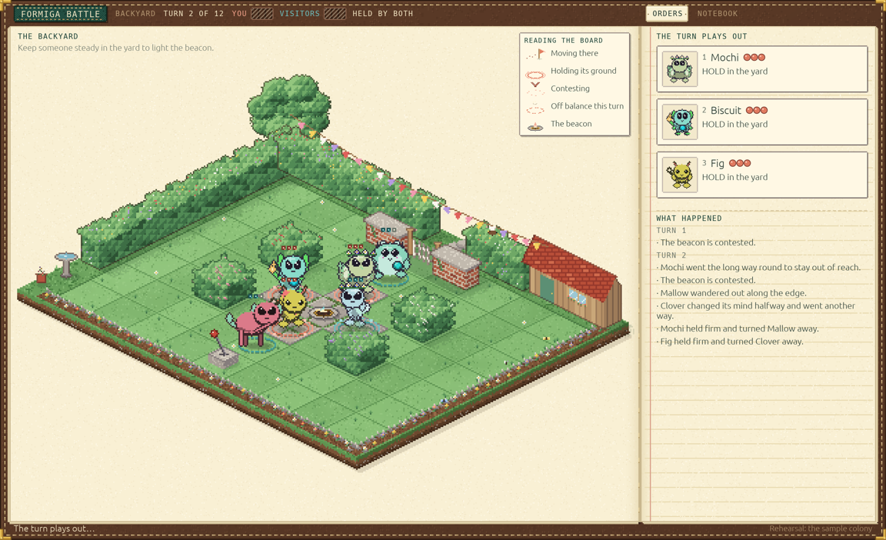

# Formiga Battle

A separate desktop app for Formiga Desktop's companions: isometric, simultaneous-order 3v3
tactics, against the AI or a friend in a private room. You are the Handler: each turn you give
your team up to three orders (PRESS some squares, HOLD some squares facing one way, TRICK
whoever holds some squares, INTERACT with something), and USE ITEM for anyone carrying something
besides, both teams' plans lock together, and the turn plays out at once. The Formigas share the plan out
among themselves, and who takes which job, and how each carries it out, comes from who it is in
Desktop, never from stats, so knowing your Formigas is the skill and rerolling them for a better
trio is not.

Battle opens as the Handler's notebook, in the leather, paper and stitching of Formiga Home's,
where you choose three of your companions and play the visitors, three companions from a
neighbouring colony, in one of four arenas, each a little isometric place of its own: the
Backyard (a garden of hedges, a brick wall and a potting shed), Woodland Glade (stumps, boulders
and pines), Millpond (a meadow with a footbridge, a jetty and a watermill) and Sandy Cove (a
beach with a sandbar, sea-worn rocks and a lighthouse). The creatures are
drawn exactly as Desktop draws them. Each turn you give your orders on the order cards and the
board (or let the timer run out and they choose for themselves), lock in, and watch the turn play
out tick by tick with a recap that says who took on what and why each of them did what it did. The
Handler's Notebook beside the board keeps what each of your companions has been seen to do, match
after match, so you can learn how they carry out an order. To play a friend, one of you opens a
room and reads out its code, and the other joins with it; the relay on the Formiga site passes
the plans on and keeps nothing once the match is over ([docs/FRIENDS.md](docs/FRIENDS.md)). The
same match also runs headless from the command line. Formiga Desktop opens Battle from its tray
with "Play Formiga Battle…"; Battle's side of that hand-off is `--formiga-battle <dir>`.



- [docs/RULES.md](docs/RULES.md): how a match resolves, every provisional number, and the
  fairness tournament's results.
- [docs/PERSONALITY.md](docs/PERSONALITY.md): every part of Desktop's record of a companion, and
  what Battle does with it.
- [docs/REWARDS.md](docs/REWARDS.md): what a match earns, against a friend or the visitors, and
  how Desktop keeps it.
- [docs/FRIENDS.md](docs/FRIENDS.md): playing a friend: a match through the relay, and exactly
  what is shared and kept.
- [docs/RELAY.md](docs/RELAY.md): the relay's contract, request by request, for the one on the
  Formiga site.
- [docs/PLAYBOOK.md](docs/PLAYBOOK.md): playbooks, a Handler's plan for a match in stages,
  compiled to ordinary orders each turn (a prototype in the match core).

## Getting it

1. Download Battle from [formigaworld.com](https://www.formigaworld.com), which links to the files
   on [Formiga-World-Releases](https://github.com/Von-Van/Formiga-World-Releases/releases), where
   Battle's releases are tagged `battle-vX.Y.Z`. On macOS 14 or later there is a universal app, as
   a disk image or a zip. On Windows 10 or 11 there is a per-user installer, which puts Battle
   where Formiga Desktop looks for it, or a portable zip, which runs without installing but which
   Desktop does not look for.
2. In Formiga Desktop (0.67.9 or later), choose "Play Formiga Battle…" from the tray. Battle opens
   with your companions. Opened by itself, it says where your own companions come from and
   offers a look around with a sample colony, which keeps nothing.
3. To play a friend, both of you need the same Battle, opened by the same Desktop.

Battle remembers how it looks and sounds (the music and sound volumes, the mute, reduced motion
and the window's size) in one small file of its own, `settings.json`, in its folder under
Application Support on macOS (`com.Formiga.Formiga-Battle`) and under `%APPDATA%` on Windows
(`Formiga\Formiga Battle\data`). Nothing about a colony or a match goes there: Desktop keeps the
record ([docs/REWARDS.md](docs/REWARDS.md)). Reduced motion follows Desktop's setting until you
change it in Battle's own settings. Delete the file to go back to the usual settings.

The downloads are not signed yet. On macOS, open the app the first time with Control-click → Open;
on Windows, SmartScreen may ask before it runs. To build it yourself, install
[rustup](https://rustup.rs) and use the commands below; [CONTRIBUTING.md](CONTRIBUTING.md) has
the rest.

## Commands

```bash
cargo run --release -p formiga-battle                                    # the window, as opened by itself
cargo run --release -p formiga-battle -- --sample                        # on the sample colony, no welcome card
cargo run --release -p formiga-battle -- --from-save <colony.json>       # on a colony, read and never written
cargo run --release -p formiga-battle -- --help
cargo run --release -p formiga-battle -- roster                          # the sample colony's companions
cargo run --release -p formiga-battle -- roster --from-save <colony.json> # read, never written
cargo run --release -p formiga-battle -- match --seed 4 --board          # an AI match, told turn by turn
cargo run --release -p formiga-battle -- match --from-save <colony.json> --left 0,2,3 --record m.json
cargo run --release -p formiga-battle -- replay m.json                   # replays and checks every turn
cargo run --release -p formiga-battle -- tournament --pairings 5000      # fairness by kind and trio
cargo run --release -p formiga-battle -- tournament --coach familiar,generic  # what knowing them is worth
cargo run --release -p formiga-battle -- arena                           # draws Backyard
cargo run --release -p formiga-battle -- relay                           # a local relay, for development
```

Battle opens at the Battleground, the first spread of the Handler's notebook: the colony's
train pulls in with your companions aboard on its left page, and on its right you
choose Out in the World (a friend, online) or Close to Home (the visitors, offline). The notebook
then turns to where to play, who goes and, for a friend, the room.

In a match: give the team up to three orders a turn, each a Press, Hold, Trick or Interact (or P,
H, T, I) put on a square of the board, and a Use Item (U) for anyone carrying something besides;
R or the mouse wheel turns the way a Hold faces. Enter locks in, Escape puts an order back, and L
opens the whole match turn by turn.

Review pictures, without touching the screen: `--render-board <png>` draws the board with no
window (`--turns`, `--into`, `--scale`); `--render-window <png> --review
station|welcome|where|who|friend|orders|playing --at <s>` pictures the whole window, as a Retina screen
shows it, without opening one; `--snap <png>` with the same options opens the window behind
everything, pictures it and closes. None of them reads or writes Battle's settings, so a picture
looks the same on every machine. Each takes `--arena backyard|woodland|millpond|cove`. Look at them after changing anything
visual.

The gate, run locally (Battle has no GitHub Actions, so nothing runs on GitHub):

```bash
cargo fmt --all --check && cargo clippy --workspace --all-targets -- -D warnings && cargo test --workspace
```

The developer toolkit in Desktop runs Battle's tests against a Desktop checkout's own crates:
`devtools/formiga validate --expansions --step battle`.

## Releasing

Battle is released with Formiga Desktop, under the same version. Its repository runs no Actions:
Formiga-World-Releases builds it from its tag `vX.Y.Z` and keeps the downloads, and the website
offers them from there. A release needs its `## [X.Y.Z] - date` section in `CHANGELOG.md`, and
`scripts/set-version.sh X.Y.Z vX.Y.Z` to move the version and Desktop's tag together
(`scripts/set-version.sh --check` says whether every place agrees).

`scripts/package-macos.sh` builds the universal app, its zip and DMG into `dist/`, and
`scripts/package-windows.ps1` the Windows zip and per-user installer. Both name Battle the way
`formiga-battle-contract`'s `discovery` module says Desktop looks for it: the bundle id and
`FormigaBattleVersion` on macOS, the `Software\Formiga\Battle` registry values on Windows, with
the battle version and the icon asked of the program itself (`--battle-version`, `--icon <dir>`).
Each prints its program's SHA-256 last: that is how the site's friend-match relay knows a release.

## Crates

- **`formiga-battle-core`**: the rules, with no drawing, clock or network. `arena` (boards as
  data, in `arenas/`), `order` (a team's plan, and each creature's order), `muster` (how a team
  shares out its plan, and thinks again partway through a turn), `game` (a match, and a turn tick
  by tick), `profile` (a creature as Desktop records it), `interpret` (how a creature carries out
  its order, and why), `ai` (the fallback for a creature with no plan, and the AI coaches), `plan` (coaches that think a turn ahead,
  knowing their creatures or not), `notebook` (what each creature was seen to do), `recap`,
  `replay` and `tournament`.
- **`formiga-battle-contract`**: what Desktop hands Battle, a read-only roster built from
  Desktop's own trip projection (`formiga-travel`) plus the learned leanings a trip leaves at
  home, and Battle's acknowledgement, read and written through `formiga-expansion-rulebook` like
  every companion app's documents. It is Desktop's, taken from Desktop's release tag like its
  other shared crates.
- **`formiga-battle-room`**: playing a friend. `relay` (the relay as a state machine: rooms,
  seats, deadlines, forfeits; the reference the site's relay follows), `http` (the client Battle
  uses, and a local relay), `code` (invite codes) and `roster` (a team of Desktop's companions
  read as match profiles, the same on every machine).
- **`formiga-battle`**: the app. `host` (Desktop's session, or a rehearsal), `friend` (the line to the relay, on a thread of
  its own), `table` (one sitting
  at the board without the window: picking, orders, locking, the turn being shown; `table/relay` a friend's seat in a room on the relay), `playback`
  (a resolved turn at any moment, from its events), `scene` and `iso` (the board painted with
  `formiga-art`'s tools at pixel scale, and the marks laid over it), `garden` (each arena as a
  place: its ground, what stands on it and round it, and what moves there, dressed by the
  arena's id; `garden/backyard`, `garden/woodland`, `garden/millpond` and `garden/cove` each place's own pieces), `chrome` (the notebook round the window, painted as Home's is), `look` (each creature's own frames), `station` (the Battleground the
  train brings the companions to), `feel` (how every control answers a touch), `ticket` (the station's two choices, painted as
  railway tickets), `masthead` (the painted scene heading the station's page), `app` (the egui window; `app/menus` the station and the
  notebook's pages of getting ready, `app/handler` its history and settings, `app/registry` the Handler's page and trios, `app/match_screen` the match on screen, `app/widgets` the little painted pieces the pages share), `settings` (the volumes, mute, motion and window size Battle keeps for next time), `identity` (the pennant's choices, a Handler's standing, which trio three picked companions are), `pennant` (a pennant, painted), `rewards` (what a finished match earns), `cli` (the headless commands), and the smaller `announce`, `found`, `heraldry`, `keepsake`, `lettering`, `still`, `sound` and `icon`.

`formiga-core`, `formiga-art`, `formiga-travel`, `formiga-expansion-rulebook` and
`formiga-battle-contract` come from Desktop by one release tag (`v0.67.14`) in the root `Cargo.toml`, so their types agree with Desktop's. Desktop is
authoritative for the colony; Battle never writes a colony file, and the only file it keeps is
its own `settings.json`.

## License

MIT. See [LICENSE](LICENSE). Formiga is a personal project and does not take outside pull requests,
but forks are welcome: [CONTRIBUTING.md](CONTRIBUTING.md) says how to make one your own.
